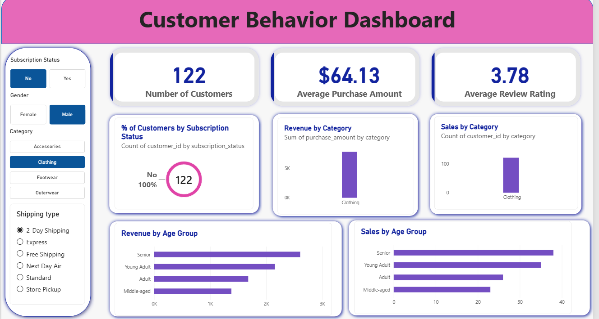

# Customer Shopping Behavior Analysis

End-to-end data analytics project using **Python, PostgreSQL and Power BI** to find out what drives customer spending and loyalty in a retail business.

## Overview

A retail company wants to understand its customers' shopping behavior to improve sales, satisfaction and loyalty. This project answers one business question:

> How can the company use customer data to spot trends, improve engagement, and optimize marketing and product strategy?

I cleaned the data in Python, answered 10 business questions with SQL, and built an interactive Power BI dashboard.

## Dataset

- **Size:** about 3,900 customers, 18 columns (one row per customer's latest purchase)
- **Key columns:** age, gender, item purchased, category, purchase amount, review rating, subscription status, shipping type, discount applied, previous purchases, purchase frequency
- **File:** `customer_shopping_behavior.csv`

## Tools

| Tool | Used for |
|---|---|
| Python (Pandas, SQLAlchemy) | Data cleaning, feature engineering, loading data into PostgreSQL |
| Jupyter Notebook | Running and documenting the analysis |
| PostgreSQL + pgAdmin | Storing the data and running SQL queries |
| Power BI | Interactive dashboard |
| GitHub | Version control and portfolio |

## Steps

**1. Data cleaning and EDA (Python)**
- Inspected the structure, data types and summary statistics.
- Filled 37 missing review ratings with the **median rating of each product category**, which avoids bias from one overall median.
- Converted column names to snake_case.
- Created `age_group` (4 groups) and `purchase_frequency_days` (text frequency converted to days).
- Removed `promo_code_used`, which duplicated `discount_applied`.

**2. SQL analysis (PostgreSQL)**
Loaded the clean data into PostgreSQL and wrote 10 queries using aggregations, subqueries, CTEs, `CASE` statements and window functions (`ROW_NUMBER`). Topics:
- Revenue by gender and by age group
- Discount-driven purchases and discount dependence by product
- Top-rated products and top 3 products per category
- Standard vs Express shipping
- Subscribers vs non-subscribers
- Customer segmentation (New / Returning / Loyal)

**3. Dashboard (Power BI)**
Connected Power BI directly to PostgreSQL and built KPI cards, charts and slicers.

## Dashboard



The dashboard shows total customers, average purchase amount and average review rating. It also shows revenue and sales by category and age group, and subscription split. Slicers filter by subscription status, gender, category and shipping type.

## Results

- **Express shipping customers spend more** on average than Standard, so faster delivery is worth investing in.
- **Non-subscribers generate most of the revenue** with a similar average spend, so the subscription program has room to grow.
- **Most repeat buyers are not subscribed** (about 2,500 not subscribed vs about 958 subscribed), so the subscription offer may not be attractive enough for loyal customers.
- **Young adults bring the most revenue**, followed by middle-aged customers.
- **Gloves, sandals, boots, hats and skirts are rated highest**, and are good candidates for marketing and premium pricing.

## How to Run

1. Install Python 3.13, PostgreSQL and Power BI Desktop.
2. Install the libraries:
   ```
   pip install notebook pandas numpy matplotlib seaborn sqlalchemy psycopg2-binary
   ```
3. Create a PostgreSQL database named `customer_behavior`.
4. Open the notebook, replace `YOUR_PASSWORD` in the connection cell with your own PostgreSQL password, and run all cells.
5. Run the queries from `customer_behavior_sql_queries.sql` in pgAdmin's Query Tool.
6. Open `customer_behavior_dashboard.pbix` in Power BI Desktop.

## Files

| File | Description |
|---|---|
| `customer_behavior_analysis.ipynb` | Python cleaning and analysis |
| `customer_shopping_behavior.csv` | Dataset |
| `customer_behavior_sql_queries.sql` | 10 SQL business queries |
| `customer_behavior_dashboard.pbix` | Power BI dashboard |
| `dashboard_screenshot.png` | Dashboard preview |

## Acknowledgements

I built this project by following a tutorial by [Amlan Mohanty](https://www.youtube.com/@amlanmohanty1) and using the dataset provided with it.

## Author

**Jannathul Firthose S**
ECE graduate | Data analytics | Embedded systems
[LinkedIn](https://linkedin.com/in/jannathul-firthose-s-a2aa10255)
